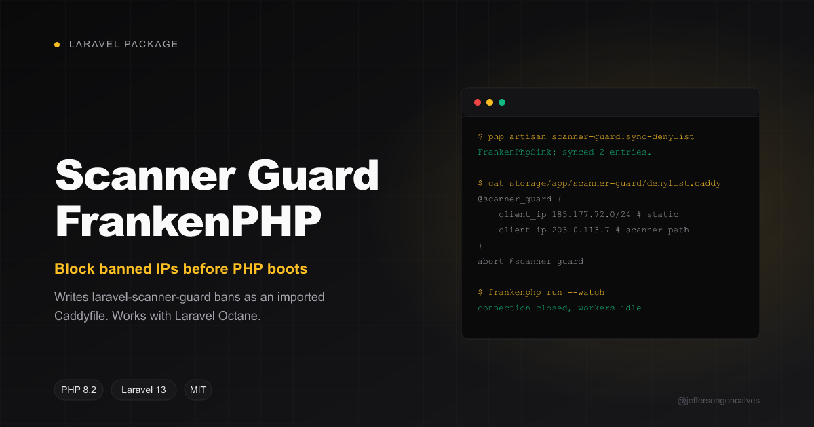

<div class="filament-hidden">



</div>

# Laravel Scanner Guard FrankenPHP

[](https://packagist.org/packages/jeffersongoncalves/laravel-scanner-guard-frankenphp)
[](https://github.com/jeffersongoncalves/laravel-scanner-guard-frankenphp/actions/workflows/tests.yml)
[](https://packagist.org/packages/jeffersongoncalves/laravel-scanner-guard-frankenphp)

FrankenPHP denylist sink for [`laravel-scanner-guard`](https://github.com/jeffersongoncalves/laravel-scanner-guard).
Writes every banned IP and `ip_blocklist` entry as a Caddyfile snippet, so banned scanners have their
connection closed by FrankenPHP's embedded Caddy before PHP runs. Works with the plain FrankenPHP
server and with Laravel Octane.

Built on [`laravel-scanner-guard-caddy`](https://github.com/jeffersongoncalves/laravel-scanner-guard-caddy),
which writes the same file. This package never reloads the server from inside one of its own
requests, where `frankenphp reload` would wait for itself.

```caddyfile
@scanner_guard {
	client_ip 185.177.72.0/24 # static
	client_ip 203.0.113.7 # scanner_path, expires 2026-11-20T10:00:00+00:00
}
abort @scanner_guard
```

## Installation

```bash
composer require jeffersongoncalves/laravel-scanner-guard-frankenphp
```

Add the sink to `config/scanner-guard.php`:

```php
'sinks' => [
    \JeffersonGoncalves\ScannerGuardFrankenPhp\FrankenPhpSink::class,
],
```

`scanner-guard:sync-denylist` now runs every minute, and right after every ban, unban and blocklist
change (see the core README's "Blocking before PHP" section). The Laravel scheduler must be running.

### FrankenPHP server

With the default Caddyfile of the `dunglas/frankenphp` images, set two environment variables on the
server:

```dotenv
CADDY_GLOBAL_OPTIONS="order abort first"
CADDY_SERVER_EXTRA_DIRECTIVES="import /app/storage/app/scanner-guard/denylist*.caddy"
```

and start it with `--watch`, so it picks up every change on its own:

```bash
frankenphp run --watch --config /etc/frankenphp/Caddyfile
```

With your own Caddyfile:

```caddyfile
{
	order abort first
}

example.com {
	import /app/storage/app/scanner-guard/denylist*.caddy
	# ...
}
```

- Keep the `*`: the server refuses to start when a plain `import` path doesn't exist yet, while a glob
  that matches nothing is fine.
- Keep `order abort first`: by default Caddy runs `handle`, `handle_path` and `route` blocks before
  `abort`, so requests they match would skip the denylist.

### Laravel Octane

Octane's Caddyfile needs no `order` option. Add the import through `config/octane.php`:

```php
'caddy' => [
    'env' => [
        'CADDY_SERVER_EXTRA_DIRECTIVES' => 'import '.storage_path('app/scanner-guard/denylist*.caddy'),
    ],
],
```

This replaces the directives Octane builds itself: if you use its Mercure hub, put your `mercure`
block in the same string. Octane doesn't start FrankenPHP with Caddy's `--watch`, so set a reload
command:

```dotenv
SCANNER_GUARD_FRANKENPHP_RELOAD_COMMAND="pkill -USR1 -x frankenphp"
```

> **`octane:reload` turns this off.** It changes the configuration through Caddy's admin API, and
> Caddy then ignores `SIGUSR1` (log: `last config unknown, ignored SIGUSR1`) until it restarts. Deploy
> by restarting the Octane process instead. Bans keep working in the middleware either way.

## Configuration

```bash
php artisan vendor:publish --tag="laravel-scanner-guard-frankenphp-config"
```

| Key | Env | Default | |
|---|---|---|---|
| `path` | `SCANNER_GUARD_FRANKENPHP_PATH` | `storage/app/scanner-guard/denylist.caddy` | relative to `base_path()` |
| `reload_command` | `SCANNER_GUARD_FRANKENPHP_RELOAD_COMMAND` | `null` | not needed with `--watch` |

The file is only rewritten when its content changes, through a temp file renamed over the target,
so the server never reads a half-written list. The `reload_command` runs after a write, never
otherwise. A non-zero exit or a timeout is logged, never thrown.

Without `--watch`, use `SIGUSR1` (Caddy 2.10+): the server re-reads its Caddyfile with its own
environment. The scheduler and queue worker must run as the same user (or root) and see the server's
process:

- `pkill -USR1 -x frankenphp` where `pkill` is installed (the Debian images don't ship it);
- `kill -USR1 1` inside a container where FrankenPHP is PID 1.

> **Avoid `frankenphp reload`.** It parses the Caddyfile with the **caller's** environment. Run from
> cron, which has almost none, placeholders such as `{$SERVER_NAME}` fall back to their defaults and
> the running site is replaced by the wrong one, with exit code 0.

With a `reload_command` set, a sync that runs inside a FrankenPHP request (`QUEUE_CONNECTION=sync`)
does nothing: the scheduled sync writes and reloads within a minute.

### Behind a proxy or CDN

`client_ip` is the connecting address unless the server trusts the proxy. Behind Cloudflare or a load
balancer, set `trusted_proxies` (and `client_ip_headers Cf-Connecting-Ip` for Cloudflare), trusting
only the proxy's ranges:

```caddyfile
{
	servers {
		trusted_proxies static 173.245.48.0/20 # ... https://www.cloudflare.com/ips/
		client_ip_headers Cf-Connecting-Ip
	}
}
```

Otherwise the denylist never matches a visitor. Cloudflare shows an aborted connection as a `520`
error page.

## Testing

```bash
composer test
```

## Changelog

Please see [CHANGELOG](CHANGELOG.md) for more information on what has changed recently.

## Credits

- [Jefferson Gonçalves](https://github.com/jeffersongoncalves)
- [All Contributors](../../contributors)

## License

The MIT License (MIT). Please see [License File](LICENSE.md) for more information.
